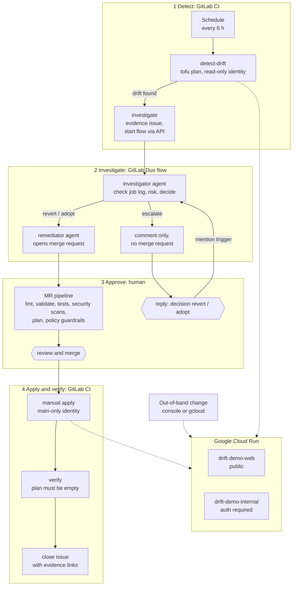

# Cloud Infrastructure Drift Detective

[](LICENSE)

**Someone changes production by hand. Drift Detective notices, works out what the change means, and opens
the merge request that fixes it. A human approves every change to the cloud.**

[▶ Demo video](https://youtu.be/X26Rk2PzTpQ) ·
[Live deployment](https://drift-demo-web-ut5yuq6zba-uc.a.run.app) ·
[Pipeline history](https://gitlab.com/gitlab-ai-hackathon/transcend-october-2026/33443675/showcase/-/pipelines) ·
[Measured evaluation](docs/evaluation.md)

Built on the GitLab Duo Agent Platform for the GitLab Transcend hackathon, and open source under the
[MIT License](LICENSE). Autonomy level: **Supervised**.
Agents detect, investigate, and prepare the fix on their own; a human approves the outcome.

## The problem

Infrastructure as code only works while the code and the cloud agree. A console click or a quick
`gcloud` command during an incident breaks that, and Terraform never finds out. Weeks later a routine
`apply` silently reverts the change, or a service that should be private sits exposed and nobody notices.

Drift Detective closes that gap inside GitLab. A scheduled pipeline detects the drift. A Duo flow
investigates it against real pipeline evidence, decides whether to **revert**, **adopt**, or
**escalate**, and opens a merge request. CI enforces guardrails, a human merges and applies, and the
pipeline verifies the result and closes the issue.

## Walkthrough: one real incident, start to finish

This is the run recorded for the demo video on 16 October 2026. Every step links to the record GitLab
kept, so you can check it yourself.

**The change.** At 03:49:19 UTC, authentication was switched off on the private internal API, outside
Terraform:

```sh
gcloud run services update drift-demo-internal --region us-central1 --no-invoker-iam-check
```

Anonymous requests to the internal API started getting `200` instead of `403`. Here is what happened next.

| Time (UTC) | Who | What happened | Record |
|---|---|---|---|
| 03:49:34 | CI | The drift-check schedule runs `detect-drift`, a read-only `tofu plan` against the live project. It finds one out-of-band change, `invoker_iam_disabled: false → true`, and writes a redacted report to the job log. | [job log](https://gitlab.com/gitlab-ai-hackathon/transcend-october-2026/33443675/showcase/-/jobs/17221312716) |
| 03:50:12 | CI | `investigate` opens an issue with the evidence and starts the Duo flow through the API. | [issue #7](https://gitlab.com/gitlab-ai-hackathon/transcend-october-2026/33443675/showcase/-/issues/7) |
| 03:51:12 | Investigator agent | Cross-checks the issue against the `detect-drift` job log, reads `terraform/main.tf`, and posts its report: **revert, High risk**. | [report](https://gitlab.com/gitlab-ai-hackathon/transcend-october-2026/33443675/showcase/-/issues/7#note_4025824870) |
| 03:51:38 | Remediator agent | Opens a merge request. `terraform/` already declares the right value, so the MR only adds an incident record. Its pipeline (format, validate, tests, security scans, plan, policy guardrails) passes at 03:53:29. | [MR !5](https://gitlab.com/gitlab-ai-hackathon/transcend-october-2026/33443675/showcase/-/merge_requests/5), [MR pipeline](https://gitlab.com/gitlab-ai-hackathon/transcend-october-2026/33443675/showcase/-/pipelines/2953589727) |
| 03:58:51 | Human | Reads the report and merges. | |
| 04:00:43 | Human | Runs the manual `apply` job. Only pipelines on `main` can obtain the identity that writes to the cloud. | [apply job](https://gitlab.com/gitlab-ai-hackathon/transcend-october-2026/33443675/showcase/-/jobs/17221410541) |
| 04:01:21 | CI | Apply finishes. Authentication is back on. | |
| 04:01:43 | CI | `verify` plans again and sees no changes, posts the evidence links, and closes the issue. Anonymous requests to the internal API get `403` again. | [verify job](https://gitlab.com/gitlab-ai-hackathon/transcend-october-2026/33443675/showcase/-/jobs/17221410542), [closing comment](https://gitlab.com/gitlab-ai-hackathon/transcend-october-2026/33443675/showcase/-/issues/7#note_4025857192) |

From the change to an open merge request took **2 min 19 s**, with no human involved. The internal API
was exposed for 12 min 2 s in total, and 7 min 13 s of that was human review: the step a Supervised design
deliberately keeps. The drift check was started by hand 14 seconds after the change so the demo didn't
have to wait. In normal operation the schedule runs every 6 hours.

**What the agent wrote.** An excerpt from its report (the full text is in
[`drift/incidents/issue-7.md`](drift/incidents/issue-7.md)):

> **Decision:** revert · **Risk:** High
>
> - Risk of leaving it: the live setting is `invoker_iam_disabled = true` on `drift-demo-internal`, which
>   is declared private. [...] Hypothesis: with IAM invoker checks disabled and that ingress setting, the
>   internal API may be callable without authentication. This breaks the guardrail
>   `drift-demo-internal must keep invoker_iam_disabled = false`.
>
> **Uncertainty**
> - The evidence does not show who changed the setting, when, or why.
> - The log shows only attributes that differ. It does not show whether the service was reached while
>   IAM checks were disabled.

The agent works only from tool output, labels every guess as a hypothesis, and says what the evidence
cannot show.

## Explore the evidence

Everything is in this public project. You don't need to sign in.

| Where | What you'll find |
|---|---|
| [Pipelines](https://gitlab.com/gitlab-ai-hackathon/transcend-october-2026/33443675/showcase/-/pipelines) | Every run since 13 October 2026, with full job logs. Filter by trigger source: `schedule` shows the 6-hourly drift checks (most find nothing and start no agent), and `merge_request_event` shows the checks on each agent merge request. |
| [Drift issues](https://gitlab.com/gitlab-ai-hackathon/transcend-october-2026/33443675/showcase/-/work_items?state=all&label_name%5B%5D=drift) | One issue per incident: the evidence, the agent's report, and the closing comment from `verify`. |
| [Merge requests](https://gitlab.com/gitlab-ai-hackathon/transcend-october-2026/33443675/showcase/-/merge_requests?scope=all&state=all) | The agent's fixes: [!1](https://gitlab.com/gitlab-ai-hackathon/transcend-october-2026/33443675/showcase/-/merge_requests/1) adopt, [!2](https://gitlab.com/gitlab-ai-hackathon/transcend-october-2026/33443675/showcase/-/merge_requests/2) and [!5](https://gitlab.com/gitlab-ai-hackathon/transcend-october-2026/33443675/showcase/-/merge_requests/5) revert, [!3](https://gitlab.com/gitlab-ai-hackathon/transcend-october-2026/33443675/showcase/-/merge_requests/3) revert after an escalation and a human decision. |
| [`drift/incidents/`](drift/incidents) | The incident records those merge requests committed. |
| [`docs/evaluation.md`](docs/evaluation.md) | Four controlled scenarios with measured timings, and the defects they uncovered. |

Issue #6 and MR !4 were an earlier take of the demo recording. Nobody was there to merge, so the recording
script restored authentication itself, and both were closed with a comment. The Duo agent sessions are
visible only to project members, but everything the agents produced is in the issues and merge requests.

## How it works



1. **Detect.** A pipeline schedule runs `tofu plan -detailed-exitcode` against the live environment
   with a read-only identity. [`scripts/summarize_plan.sh`](scripts/summarize_plan.sh) turns the plan into
   evidence. It separates out-of-band drift from unapplied code, keeps only attributes the configuration
   manages, and redacts sensitive values and personal emails. The full JSON plan never leaves the job.
2. **Hand off.** If there is real drift, [`scripts/start_drift_flow.sh`](scripts/start_drift_flow.sh)
   opens one deduplicated issue with the evidence and starts the flow through
   `POST /api/v4/ai/duo_workflows/workflows`.
3. **Investigate.** The investigator agent follows [`skills/drift-investigation/SKILL.md`](skills/drift-investigation/SKILL.md).
   It cross-checks the issue against the `detect-drift` **job log**, reads the declared Terraform,
   classifies risk, labels every guess as a hypothesis, and posts one structured report.
4. **Decide.** A conditional router sends `revert` and `adopt` to the remediator agent. `escalate` ends
   the flow with a comment and no merge request.
5. **Propose.** The remediator opens one merge request from `duo/fix/drift-issue-N`. Revert MRs only add
   an incident record, because the code is already right. Adopt MRs change only the drifted attributes.
6. **Validate.** The MR pipeline runs `fmt`, `validate`, the test suite, IaC and secret scanning behind a
   security gate, and a plan checked by [`scripts/policy_check.sh`](scripts/policy_check.sh). The
   guardrails hold even if the agent is wrong.
7. **Approve and apply.** A human merges and runs the manual `apply` job on `main`.
8. **Verify and close.** `verify` plans again and must see **no changes**. It then follows the merged MR's
   `Drift-Issue: #N` trailer, posts links to the evidence, and closes the issue.
9. **Observe.** `verify` sends the whole incident to GitLab Observability as one OpenTelemetry trace, so
   every stage of the incident is visible with its duration (see [Observability](#observability)).

If the agent escalates, the human replies on the issue with
`@ai-drift-detective-investigator-gitlab-ai-hackathon decision: revert` (or `adopt`). The mention trigger
restarts the flow with that decision, and the same loop finishes the job.

## How the agent decides

| Decision | When | Merge request |
|---|---|---|
| **escalate** | Checked first. Evidence missing or contradictory, the plan would `delete` or `replace`, a runtime identity changed, or the agent is unsure | None. Both options are laid out for a human |
| **revert** | Any other High-risk drift (authentication weakened, invokers changed), or anything it cannot justify adopting | Incident record only; apply restores the declared state |
| **adopt** | Low risk (or Medium with no security impact), within every guardrail, and reverting would plausibly reduce availability | Smallest `terraform/` edit plus incident record |

Guardrails, enforced in CI on every plan: the internal service must require authentication, no
`allUsers`/`allAuthenticatedUsers` invokers, `max_instance_count` at most 5, and the `managed-by = terraform`
label on every service.

## Results

Measured on the live environment. The full timings, caveats, and defects found are in
[docs/evaluation.md](docs/evaluation.md).

| Scenario | Agent decision | Detection → MR or escalation | Apply → verified and closed |
|---|---|---|---|
| Capacity raised 2 → 4 with gcloud | adopt (Low) | 2 min 33 s | 46 s |
| Internal API authentication disabled | revert (High) | 2 min 23 s | 68 s |
| No drift | no issue, no agent run | 46 s (detection only) | n/a |
| Internal API identity swapped | escalate (High), then revert on human decision | 2 min 16 s | 63 s |

The [walkthrough](#walkthrough-one-real-incident-start-to-finish) run on 16 October repeated the second
scenario: 2 min 4 s from detection to merge request, and 61 s from apply to a verified, closed issue.

Detection was triggered by hand right after each change. On the 6-hour schedule, detection itself can
take up to 6 hours.

## Security model

**Enforced by design.** These hold regardless of what the model does.

- **No long-lived cloud keys.** CI exchanges its OIDC token for short-lived Google credentials
  (workload identity federation, which rejects tokens from any other GitLab project).
- **Two identities.** `drift-plan` (`roles/run.viewer`) is used for detection and every plan.
  `drift-apply` (`roles/run.admin`) can only be obtained by pipelines on `main`. In this pipeline,
  only the manual `apply` job requests it.
- **The agent cannot change cloud infrastructure.** The flow never receives cloud credentials, and it has
  no tools to merge, approve, or run pipelines.
- **Guardrails don't depend on the agent.** `policy_check.sh` fails any plan that breaks a guardrail,
  so an unsafe "adopt" cannot pass CI.
- **Published evidence is redacted.** A script masks sensitive values and removes personal emails before
  anything reaches an issue. The raw JSON plan never becomes an artifact. The binary plan cache that
  `apply` needs is an artifact, restricted to project members (`access: developer`).

**Required by the playbook.** The agent followed these in every evaluation run, but they are
instructions in [`SKILL.md`](skills/drift-investigation/SKILL.md), not technical controls.

- Work only from tool output (the issue, the job log, the repository), and label every guess as a hypothesis.
- Escalate on identity changes, delete or replace plans, contradictory evidence, or uncertainty.
- Open at most one merge request per incident, touching only `terraform/` and `drift/incidents/`.
- Act on a human's decision only when it uses the exact wording `decision: revert` or `decision: adopt`.

**Known limits** (from the hackathon's Developer role, documented rather than hidden):
- `main` is not protected against Developer pushes. Two consequences:
  - "main only" for the apply identity is weaker than in a real setup.
  - The flow's service account could technically commit directly to `main`. Nothing reaches the cloud
    without a human running `apply`.

  With Maintainer access, protect `main` and the `demo` environment, and require merge request approval.
- The flow is started with a personal access token (`DUO_FLOW_TOKEN`, `api` scope) in a masked, unprotected
  CI variable. GitLab triggers ignore bot users, so a human token is needed to start flows from CI.
- Plans run with `-lock=false`, because the flow's service account can read but not lock state. Apply
  still locks, and `resource_group` serializes every job that touches the state.

## Observability

Every resolved incident becomes one OpenTelemetry trace in the group's GitLab Observability instance
(service `drift-detective`). [`scripts/incident_trace.sh`](scripts/incident_trace.sh) builds it from GitLab's
own records and sends it over OTLP/HTTP:

| Span | Timing source |
|---|---|
| `drift incident #N` (root; attributes `drift.decision`, `drift.risk`, `drift.escalated`) | detect start → issue closed |
| `detect-drift`, `investigate`, `apply`, `verify` | CI jobs API (exact) |
| agent investigation, human decision, agent opens MR, human review and merge | issue, comment, and MR timestamps (`drift.reconstructed = true`) |

The agent runs inside GitLab Duo and cannot emit spans itself. Its stages are reconstructed from the
records it leaves behind, and are labelled as such. The pipelines are also traced automatically through
GitLab's CI/CD pipeline instrumentation (`GITLAB_OBSERVABILITY_EXPORT=traces`). Telemetry is best-effort:
a failed export only logs a warning and never fails `verify`.

## GitLab features used

- **Duo Agent Platform:** a custom flow with two agents and a conditional router, kept as YAML in
  [`flows/`](flows) and published by [`scripts/publish_flow.sh`](scripts/publish_flow.sh) through the
  AI Catalog GraphQL API. It is started by the workflows REST API, and resumed by a **mention trigger**.
- **Project skill:** [`skills/drift-investigation/SKILL.md`](skills/drift-investigation/SKILL.md) is the
  agent's playbook, versioned and reviewed like code.
- **CI/CD:** pipeline schedules, a manual job as the approval gate, environments, `resource_group`
  serialization, dotenv artifacts between jobs, the Terraform MR widget report, and **OIDC `id_tokens`**.
- **Security scanning:** IaC SAST (KICS) and secret detection templates, made blocking by
  [`scripts/security_gate.sh`](scripts/security_gate.sh), which fails on Critical or High findings.
- **GitLab-managed OpenTofu state** and the official `gitlab-opentofu` image from the
  [OpenTofu CI/CD component](https://gitlab.com/components/opentofu).
- **GitLab Observability:** a per-incident OpenTelemetry trace plus automatic CI/CD pipeline traces.
- **Issues and merge requests** as the audit trail: scoped labels (`drift::investigating` → `drift::resolved`),
  and closing driven by a merge-request trailer.

## Run it yourself

Requires a GitLab project with Duo Agent Platform (custom flows enabled), a Google Cloud project with
billing, and `tofu` (or `terraform`), `gcloud`, `glab`, and `jq` installed.

1. **Point it at your projects.** Replace `drift-detective-2026`, the project number, and the GitLab path
   in `bootstrap/variables.tf`, `terraform/variables.tf`, and the `variables` and `id_tokens` in `.gitlab-ci.yml`.
2. **Bootstrap Google Cloud** (identities only, local state):
   ```sh
   gcloud services enable run.googleapis.com iam.googleapis.com iamcredentials.googleapis.com \
     sts.googleapis.com cloudresourcemanager.googleapis.com
   cd bootstrap && tofu init && tofu apply
   ```
3. **Add the CI variable** `DUO_FLOW_TOKEN`: a personal access token with `api` scope, masked.
4. **Publish and enable the flow:**
   ```sh
   GITLAB_TOKEN=$(glab config get token) GITLAB_PROJECT_ID=<id> \
     scripts/publish_flow.sh drift-detective-investigator flows/drift-investigator.yml "Drift investigator"
   ```
5. **Deploy:** push to `main`, then run the manual `apply` job. `verify` should report no changes.
6. **Schedule detection:** create a pipeline schedule on `main` (for example `0 */6 * * *`). Scheduled
   pipelines run only `detect-drift` and `investigate`.
7. **Optional: observability.** In the group, select **Observe → Setup → Enable Observability**. Then add
   the CI/CD variables `OTEL_EXPORTER_OTLP_ENDPOINT` (the endpoint shown there) and
   `GITLAB_OBSERVABILITY_EXPORT=traces`. To backfill an incident that is already resolved, run
   `OTEL_EXPORTER_OTLP_ENDPOINT=... GITLAB_API=https://gitlab.com/api/v4 PROJECT_ID=<id> GITLAB_AUTH_HEADER="PRIVATE-TOKEN: <token>" scripts/incident_trace.sh <issue iid>`.
   Without `OTEL_EXPORTER_OTLP_ENDPOINT`, it prints the OTLP payload instead.

**Try a scenario**, then select **Run** on the schedule:

```sh
gcloud run services update drift-demo-web --region us-central1 --max-instances 4      # expect adopt
gcloud run services update drift-demo-internal --region us-central1 --no-invoker-iam-check  # expect revert
gcloud run services update drift-demo-internal --region us-central1 \
  --service-account drift-demo-web@<project>.iam.gserviceaccount.com                  # expect escalate
```

Run the tests locally with `tests/run_tests.sh` (needs only `sh` and `jq`).

## Repository layout

```text
.gitlab-ci.yml                  validate, secure, plan, apply, verify, drift, investigate
bootstrap/                      one-time: workload identity federation and service accounts
terraform/                      the managed environment (two Cloud Run services and an IAM binding)
flows/drift-investigator.yml    the Duo custom flow (investigator and remediator)
flows/integration-probe.yml     phase 1 probe: can a flow started from the API read pipeline evidence?
skills/drift-investigation/     the agent's playbook
scripts/                        GCP auth, evidence, policy and security gates, flow start, issue closing,
                                flow publishing, incident traces
tests/                          tests for the evidence, policy, and security gate scripts
drift/incidents/                incident records committed by the agent's merge requests
docs/                           measured evaluation, architecture diagram (PNG)
```

## Cost and teardown

Both services scale to zero, so the environment costs close to nothing at idle. A $10 budget alert is
set on the project. Each agent investigation uses GitLab Credits, and drift checks that find nothing
start no agent.

To remove everything: delete the pipeline schedule, delete the `demo` Terraform state
(**Operate → Terraform states**), remove the flow from the AI Catalog, and run
`gcloud projects delete drift-detective-2026`.

## License

Released under the [MIT License](LICENSE). Copyright (c) 2026 Lazare Herzi.
